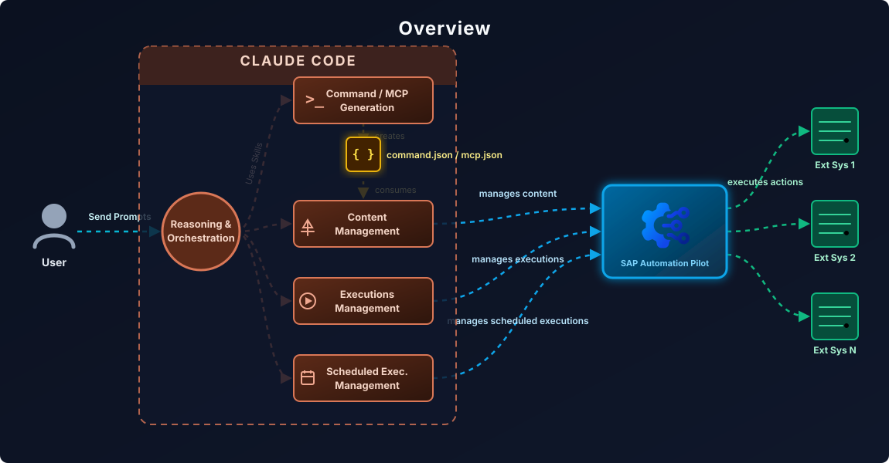

[](https://api.reuse.software/info/github.com/SAP/automation-pilot-agent-skills)

#  SAP Automation Pilot Agent Skills

### Create and operate SAP BTP automations through your coding agent.

This repository provides agent skills and a bundled CLI for [SAP Automation Pilot](https://help.sap.com/docs/automation-pilot). Using [Claude Code](https://claude.ai/code), you can author reusable Commands through natural conversation, with guidance for JSON schemas, dynamic expressions, and service contracts. Review definitions, deploy to your tenant, trigger Executions, and troubleshoot failures from your IDE or terminal.



**What makes the difference:**

- **Instant expertise** — SAP's proven patterns and best practices guide every Command you create
- **End-to-end workflow** — From "I need an automation that..." to deployed and running
- **Validation and control** — Guidance for error handling, retries, sensitive values, and verification before deployment
- **Zero context switching** — Generate, review, deploy, trigger, monitor, and troubleshoot in one place

## Table of contents

- [About SAP Automation Pilot](#about-sap-automation-pilot)
- [Why this repository](#why-this-repository)
- [What's included](#whats-included)
- [Getting started](#getting-started)
- [How to use](#how-to-use)
- [Resources](#resources)
- [Support and contributing](#support-and-contributing)
- [License](#license)

## About SAP Automation Pilot

 [SAP Automation Pilot](https://help.sap.com/docs/automation-pilot) is SAP's native automation engine for Business Technology Platform — the control plane for your BTP operations. From routine maintenance to complex incident response, it handles the workflows that keep your landscape running.

Think of it as Infrastructure-as-Code meets workflow automation, purpose-built for SAP BTP. **Commands** define your automations, **Inputs** store credentials and configuration, and **Executions** are running instances you can monitor and troubleshoot.

**What you can automate:**

| Category | Services & Capabilities |
|----------|------------------------|
| **SAP HANA Cloud** | Lifecycle management, updates, mass operations, backups, audit logs, credential rotation |
| **BTP Management** | Subaccount creation, environment setup, entitlements, identity provider configuration |
| **Cloud Foundry** | Apps, services, spaces, routes, mass restart/stop/start, quota notifications, certificate checks |
| **Kubernetes/Kyma** | Deployments, pods, services, jobs, config maps, secrets, script execution via K8s |
| **Neo** | Application lifecycle, auto-scaling, process management |
| **Service Manager** | Instances, bindings, plans, platforms, service keys |
| **SAP Cloud ALM** | Health monitoring, Cloud Connector status, metrics collection |
| **AI Core** | GPT completions, AI model orchestration |
| **Monitoring** | Dynatrace integration, availability checks, alert correlation |
| **DevOps** | GitHub workflows, Jenkins pipelines, JIRA issue management |
| **Notifications** | Email/SMTP, Alert Notification Service (ANS), Slack via webhooks |
| **Security** | XSUAA token management, destination service, credential rotation |
| **Database** | SQL operations, database lifecycle management |
| **Transport** | Cloud Transport Management System (cTMS) operations |
| **HTTP/REST** | Any API with OAuth, basic auth, certificates, Cloud Connector |
| **Scripting** | Bash, Python, Node.js, PowerShell, Terraform with BTP Provider |
| **Utilities** | Data transformation, JSON-to-HTML, parallel execution (ForEach), delays |

## Why this repository

SAP Automation Pilot provides a powerful automation engine with hundreds of built-in Commands and a rich expression language. **This repository amplifies that power with AI-assisted development.**

Think of it as a force multiplier: these skills encode expert-level patterns — Command structures, expression syntax, security requirements, error handling strategies — and apply them automatically as you work. You focus on *what* you want to automate; the AI handles the implementation details.

**Who benefits:**

| You are... | How AI skills help |
|------------|-------------------|
| **Getting started** | Generate your first Command in minutes through natural conversation |
| **Building complex workflows** | Get production-quality Commands with error handling and validation built in |
| **Reviewing team code** | Automated checks for security, naming conventions, and best practices |
| **Operating at scale** | Trigger, monitor, and troubleshoot Executions — all via CLI |
| **Integrating with CI/CD** | API skills plug directly into your automation pipelines |

## What's included

| Skill | Description |
|-------|-------------|
| [**Automation Pilot CLI**](skills/automation-pilot-cli/SKILL.md) | The bundled `autopi` CLI with checksum verification — every skill uses it to call the API and run `autopi lint` |
| [**Plan**](skills/automation-pilot-plan/SKILL.md) | Design an automation from settled decisions or an interview, then produce an implementation-ready specification |
| [**Connection**](skills/automation-pilot-connection/SKILL.md) | Validate the configured connection and report the non-secret account summary (tenant, permissions, plan) |
| [**Discovery**](skills/automation-pilot-discovery/SKILL.md) | Find and evaluate existing Catalogs, Commands, child dependencies, and reusable Inputs before building |
| [**Catalogs**](skills/automation-pilot-catalogs/SKILL.md) | Create and manage custom Catalogs with purposeful reuse, capacity checks, and verified metadata changes |
| [**Command Authoring**](skills/automation-pilot-command-authoring/SKILL.md) | Author and maintain Commands and composite automations — contracts, executor flows, expressions, error handling |
| [**Inputs**](skills/automation-pilot-inputs/SKILL.md) | Create, rotate, explain, and delete reusable Inputs that store configuration and credentials |
| [**Executions**](skills/automation-pilot-executions/SKILL.md) | Trigger Commands, monitor status, inspect input/output/logs, diagnose failures, analyze history |
| [**Scheduling**](skills/automation-pilot-scheduling/SKILL.md) | Create and manage one-time and recurring Command schedules |
| [**MCP Servers**](skills/automation-pilot-mcp-servers/SKILL.md) | Create MCP server definitions that expose Commands as MCP tools for AI assistants |
| [**Tags**](skills/automation-pilot-tags/SKILL.md) | Validate, apply, and interpret regular, feature, and service tags (priority, retention, auto-abort, logging, lineage) |
| [**Dynamic Expressions**](skills/automation-pilot-dynamic-expressions/SKILL.md) | The expression engine reference — functions, elements, and engine gotchas |

The CLI covers catalogs, commands, Inputs, MCP servers, webhooks, executions, schedules,
and triggers. It includes offline request validation, conditional updates, execution
waiting, and bulk actions; see the [capability map](skills/automation-pilot-cli/references/capabilities.md).

## Getting started

### 1. Install the plugin

In Claude Code 2.1.275 or later, run:

```text
/plugin install automation-pilot-skills --marketplace SAP/automation-pilot-agent-skills
```

Or install from your terminal:

```bash
claude plugin install automation-pilot-skills --marketplace SAP/automation-pilot-agent-skills
```

Restart the session after installation. The plugin includes all 12 skills, their
references and examples, and prebuilt `autopi` binaries for macOS ARM64/x64,
Linux ARM64/x64, and Windows x64. There is no repository clone, PATH configuration,
Go, Python, or build step to complete. The skills resolve their bundled launchers
inside the installed plugin. `jq` is optional for your own JSON processing.

Every CLI invocation verifies the selected binary's SHA-256. macOS/Linux use the
standard `shasum` or `sha256sum`; Windows uses PowerShell's `Get-FileHash` and honors
host execution policy. Install from the trusted SAP repository. See
[bundle provenance](skills/automation-pilot-cli/references/distribution.md)
for authenticated release archives and checksum-failure recovery.

### 2. Configure credentials when you need tenant access

Local planning, authoring, help, lint, and request previews work immediately without
credentials. For tenant operations, provide these variables through your approved
secret source in the environment that launches your agent:

| Variable | Value |
|---|---|
| `AUTOMATION_PILOT_HOSTNAME` | Regional hostname without scheme or path, such as `emea.autopilot.cloud.sap` |
| `AUTOMATION_PILOT_TOKEN` | Your Bearer token without the `Bearer ` prefix |

Supported regions are `emea`, `amer`, `apac`, `aus`, and `ksa` under
`autopilot.cloud.sap`. Connection configuration is environment-only. The CLI and
plugin do not load `.env` or inject credentials. If you use a trusted local `.env`,
protect it, keep it outside version control, and load it in the launching shell.
On Windows, set the variables in the PowerShell session that launches the agent.
An already-running desktop app needs its launch environment configured or a restart
from the configured shell. Never paste tokens into chat or print the environment.

### 3. Check setup

Invoke `/automation-pilot-skills:automation-pilot-connection` or ask:

```text
Check my Automation Pilot setup and confirm which tenant and permissions are configured.
```

The skill uses the installed verified launcher. `connection preflight` checks local
configuration without connecting or printing its values; `connection info` verifies
live tenant identity and access. Missing credentials do not prevent local-only work.

### Developing the plugin

Contributors can clone this repository and use `claude --plugin-dir .` from its root.
For other agents, register all folders under `skills/` using that client's skill
mechanism, retaining their sibling layout and bundled assets. Opening a clone alone
does not register skills. See [contributor checks](https://github.com/SAP/automation-pilot-agent-skills/tree/main/ci/README.md), including the real
marketplace-install acceptance test.

## How to use

Start a conversation in the agent session with the plugin loaded. Reviews and local-only
authoring stay local; deployment and execution follow the scope you request.

#### Generate a Command

```
Create an Automation Pilot Command that restarts a Cloud Foundry app 
and waits for it to become healthy, with proper error handling.
```

#### Review a Command

```
Review MyCommand.command.json for production readiness
```

#### Deploy to Automation Pilot

```
Upload MyCommand.command.json to my Automation Pilot tenant
```

#### Trigger and monitor an Execution

```
Trigger the Command my-catalog:MyCommand:1 with Input {"appName": "my-app"}
and show me the results when it finishes
```

#### Troubleshoot a failed Execution

```
The Execution abc123 failed — show me the logs and help me understand what went wrong
```

#### Check recent Execution health

```
Show me my last 15 executions — how many passed and how many failed?
```

#### Manage scheduled Executions

```
Do I have any enabled scheduled executions? List them and disable the ones that are active.
```

## Resources

- [Reusable skills evaluation suite](https://github.com/SAP/automation-pilot-agent-skills/tree/main/ci/evals/skills-e2e/README.md) — complex workflows, behavioral scoring, a Go harness, cleanup, and efficiency measurements.
- [Build and validation tools](https://github.com/SAP/automation-pilot-agent-skills/tree/main/ci/README.md) — contributor helpers, CLI and harness tests, help parity, and guidance link checks.

**SAP Automation Pilot:**

- [Official Documentation](https://help.sap.com/docs/automation-pilot) — Complete guides, API reference, expression language
- [SAP Automation Pilot Examples](https://github.com/SAP-samples/automation-pilot-examples) — Ready-to-import examples for HANA Cloud, BTP, Cloud Foundry, Kubernetes, and more
- [SAP Community](https://community.sap.com/t5/technology-blogs-by-sap/bg-p/technology-blog-sap) — Blog posts, tips, and community discussions

**Claude Code:**

- [Claude Code Documentation](https://docs.anthropic.com/en/docs/claude-code) — Installation, configuration, and usage guides
- [Claude Code GitHub](https://github.com/anthropics/claude-code) — Report issues, request features

## Support and contributing

This project is open to feature requests, bug reports, and contributions via [GitHub Issues](https://github.com/SAP/automation-pilot-agent-skills/issues).

For contribution guidelines, see [CONTRIBUTING.md](https://github.com/SAP/automation-pilot-agent-skills/blob/main/CONTRIBUTING.md).

### Security

If you discover a security vulnerability, please follow our [security policy](https://github.com/SAP/automation-pilot-agent-skills/security/policy) on how to report it. Please do not create GitHub issues for security-related doubts or problems.

### Code of conduct

We as members, contributors, and leaders pledge to make participation in our community a harassment-free experience for everyone. By participating in this project, you agree to abide by its [Code of Conduct](https://github.com/SAP/.github/blob/main/CODE_OF_CONDUCT.md) at all times.

## License

Copyright 2026 SAP SE or an SAP affiliate company and automation-pilot-agent-skills contributors. See [LICENSE](LICENSE) for details. Third-party component information is available via the [REUSE tool](https://api.reuse.software/info/github.com/SAP/automation-pilot-agent-skills).
