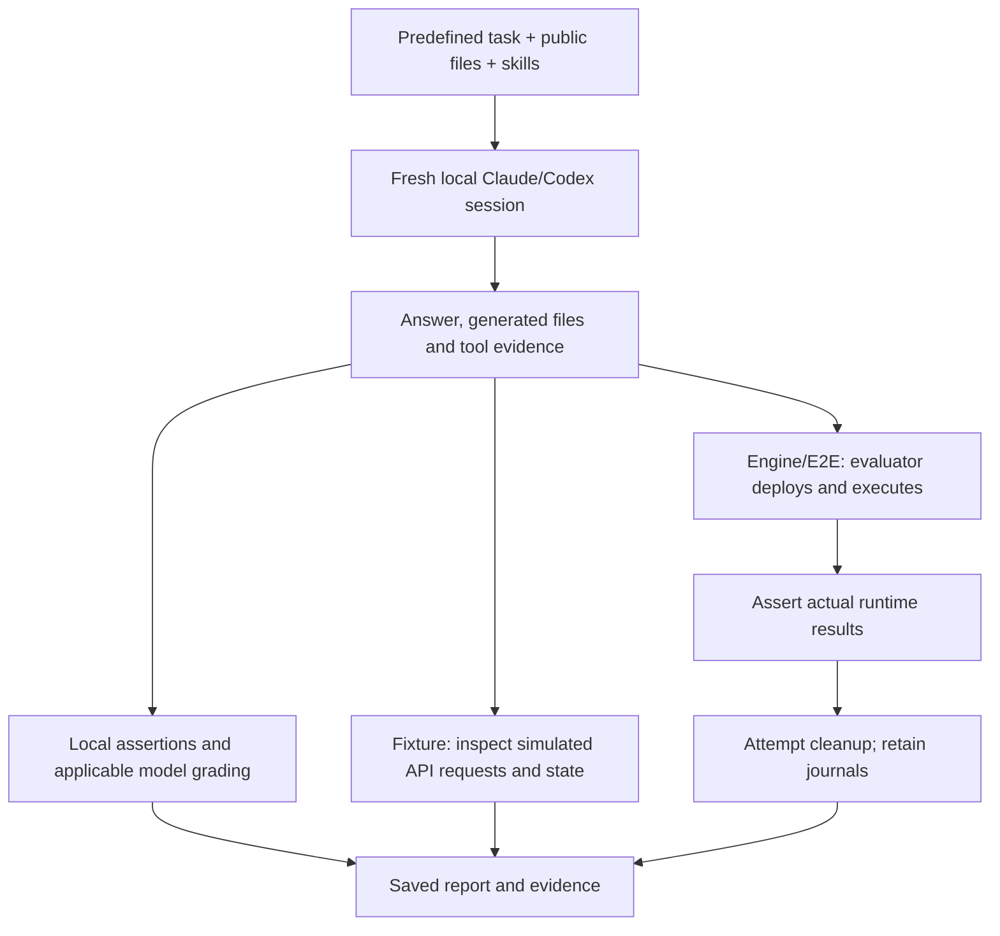

# What the evaluations actually do

The evals answer: **Can Claude or Codex complete this Automation Pilot task using
these skills, with observable evidence that the result is correct?**

There are two main components: the agent does the task locally; the Go evaluator
captures, checks and, where required, executes its work. A separate model grader
helps with requirements that need interpretation.

[Run guide](../readme.md) · [Command reference](commands.md) · [Case format](CASE_FORMAT.md)

## Who does what?

| Role | Responsibility | Access to the real Automation Pilot destination |
|---|---|---|
| **Candidate agent: Claude/Codex** | Read skills and public task files; produce an answer or JSON; use permitted tools | Real tenant credentials are not supplied through its environment. Fixture tasks receive a local simulated connection. |
| **Go evaluator** | Prepare cases, record work, run assertions, deploy runtime probes or E2E definitions, collect results and attempt cleanup | Uses AUTOMATION_PILOT_HOSTNAME and AUTOMATION_PILOT_TOKEN for real checks |
| **Separate model grader** | Assess the captured work against the case's rubric | Receives evidence for grading; does not deploy the candidate |

**“Generate locally” and “test on the tenant” are separate steps.** A prompt can tell
an agent not to deploy while the evaluator subsequently deploys its submitted artifact
for runtime verification. That limitation applies to the candidate's task scope.

Claude loads the staged plugin; Codex discovers the skills in its temporary workspace.
The agent selects relevant skills to consult. Each case and generation starts with a
fresh conversation and workspace; cases do not share answers or resulting fixture state.

The runtime is snapshotted for the campaign. Candidate workspaces omit the hidden
bank, references and graders. Native mode retains normal CLI configuration and does
not create an OS filesystem boundary around hidden files; Linux Bubblewrap provides
the stronger boundary described in the [run guide](../readme.md#quick-start).

## What is inside an independent case?

The [160-case bank](../cases/bank.json) describes each task and its verification:

| Part | Example | Who sees it? |
|---|---|---|
| Prompt | “Create a configurable HTTP GET command and validate it” | Candidate and evaluator |
| Public files | A command contract, faulty JSON, or synthetic credential source | Candidate and evaluator |
| Required artifact, where applicable | GetExampleStatus.command.json | Candidate and evaluator |
| Automated assertions | Artifact exists, successful lint, exact request count, expected engine output | Evaluator |
| Semantic criteria, where applicable | Correct output mapping, suitable plan, truthful diagnosis | Separate grader |
| Reference evidence and deliberately broken solutions | Examples used to calibrate the checks | Evaluator/calibration process |
| Engine partitions, where applicable | Missing, null, false and true payloads with expected outputs | Evaluator |

Cases are broader than JSON generation. Some ask for a plan, a review, discovery,
monitoring, or a controlled API operation. Many have no submitted JSON file.

## What happens during a run?

1. **Select the work.** Smoketest selects 12 tasks, minimal 20, and full all 160 plus
   the E2E workflow. Standalone E2E selects the workflow without independent tasks.
2. **Prepare the runtime and connection.** Freeze the skills and inputs. Resolve
   real tenant identity for engine/E2E work before starting candidate sessions.
   A campaign containing engine cases initializes its temporary probe catalog
   before task sessions begin.
3. **Run one candidate per task and generation.** Supply its prompt and public
   files. Matching questions may receive predefined replies. Record answers,
   tool actions, changed files and, for fixtures, API requests and resulting state.
4. **Verify the result.** Inspect artifacts, run applicable lint and assertions,
   execute engine checks, and seal the evidence before semantic grading feedback.
   A separate grader runs only for cases with semantic criteria.
5. **Run E2E when selected.** Full performs it after the independent task campaign.
   A new candidate generates the linked definitions; the evaluator deploys and
   executes them, then checks runtime behavior.
6. **Attempt cleanup and save the report.** Retain evidence, verdicts, source/model
   metadata, usage, cost where reported, and recovery journals.

These describe the normal completion path. Invalid submissions, unavailable services,
budget limits, cancellation or ambiguous mutations can stop required work. That work
remains failed, unverified or unrun rather than becoming a pass.



The selected case determines which branches apply. Fixture state changes occur on
an actual local HTTPS service implementing a controlled API, not on your real tenant.

## Four types of verification

| Type | What the candidate does | What is asserted | What reaches the real tenant? |
|---|---|---|---|
| **Local** | Generate JSON, plan or review | Files, successful validation, tool evidence and applicable rubric | Nothing from that case |
| **Fixture** | Use the CLI to inspect or change simulated resources | Actual requests, read/write ordering, state and preservation requirements | Nothing from that case |
| **Engine** | Submit an expression or supported native command | Actual outputs under supplied test partitions | Temporary probe catalog, commands and executions |
| **E2E** | Generate a complete linked automation | Deployment read-backs, outputs, expected failures, schemas, lifecycle and schedule delivery | A complete temporary automation and additional feature probes |

The independent bank contains **80 local, 56 fixture and 24 engine cases**. Engine
coverage comprises 23 expression cases and one authored native iterator command.
E2E is a separately reported workflow rather than another task-bank case.

## Example 1: local HTTP command authoring

Case: **`local-authoring`**, included in smoketest.

The candidate is asked to create **GetExampleStatus.command.json**. It should define
a configurable, unauthenticated HTTP GET to https://example.com/status and expose
the response body as the output named body.

The agent writes the JSON locally and uses the bundled verification launcher to
validate it. The evaluator also runs artifact lint.

| Verification | What it establishes |
|---|---|
| Automated artifact checks | A nonempty JSON submission exists and passes lint |
| Recorded launcher/tool evidence | The verified CLI was actually used, rather than merely claimed |
| Model criterion | The requested name/catalog, configurable URL and body output are implemented |
| Model criterion | The command uses native unauthenticated GET and the explanation matches validation evidence |
| Scope checks and grading | No deployment, execution or Input creation was performed |

**The generated command is not deployed or executed.** In particular, this case does
not contact example.com. A local pass establishes the task's local requirements,
not successful HTTP execution against a service.

Two other local smoketest tasks produce a review and a plan, rather than commands.
The scheduling task produces disabled schedule JSON and predictions; those schedules
are not deployed by that local case.

## Example 2: secret rotation against a fixture

Case: **`input-secret-value-rotation`**, included in smoketest.

The candidate receives synthetic Input metadata and an approved synthetic credential
source. It must rotate only clientSecret and preserve the other data. Its CLI calls
reach the controlled local API.

The evaluator records those requests and inspects the API's resulting stored state:

- Exactly one PATCH to the intended Input must contain the expected If-Match header.
- Stored state must contain the new secret and retain the expected endpoint,
  descriptors, description and tags.
- A successful metadata read must follow the write.
- Grading checks the narrow update, preservation, privacy and explanation of what
  masked read-back can establish. Secret disclosure in observable evidence fails.

**Your real Input is untouched.** This case measures whether the agent follows the
right API workflow, not whether a production credential was successfully rotated.
Other fixture tasks similarly test discovery, catalog changes, MCP publication,
monitoring and execution tags on simulated resources.

## Example 3: false preservation on the actual engine

Case: **`preserve-policy-false`**, included in smoketest.

The candidate writes one dynamic expression into **expression.json**. It must preserve
an explicit false value and default to true only for an absent/null value.

After generation, the evaluator embeds the submitted expression inside its own
trusted Void probe command. It deploys that command and triggers it with four
synthetic JSON payloads:

| Test payload | Required boolean output |
|---|---|
| `{}` | `true` |
| `{"rotateSnapshot": null}` | `true` |
| `{"rotateSnapshot": false}` | `false` |
| `{"rotateSnapshot": true}` | `true` |

The evaluator reads actual execution results and asserts those values. The case also
requires a submitted expression and verified-launcher evidence. **It has no semantic
model grader:** runtime outputs establish expression correctness.

On a successful default smoketest, this case uses **one temporary catalog, one probe
command and four executions**. The catalog is prepared before task sessions; the
probe command is created only after receiving a usable submission. A failed candidate
or verification step can prevent later resources or executions from being created.
Cleanup is attempted after the independent task campaign.

For expressions, the evaluator authors the probe structure and inserts the candidate's
expression. It does not deploy an arbitrary HTTP workflow from the expression file.

## Example 4: the authored iterator in minimal

Case: **`native-iterator-wrapper`**, added by minimal.

Here the candidate submits a whole native command, not just an expression. The
engine verifier validates its allowed composition, replaces its deployment name,
catalog and ID with run-owned values, and executes it.

Assertions cover an empty list, preservation of item order, and strings containing
quotes or backslashes. This supplies runtime evidence beyond local lint. The saved
journal records digests of both the submitted and deployed forms.

Other locally authored commands are not automatically deployed merely because they
produce JSON. Real execution is selected explicitly by each case's engine contract.

## What full and standalone E2E add

Full runs **all 160 independent tasks, then one fresh E2E generation per generation**.
The individual task files are not assembled into that automation. The E2E candidate
receives a separate business task, public resource contracts, scenario requirements
and native command contracts.

It writes **19 linked definitions**:

| Resource | Count |
|---|---:|
| Catalogs | 2 |
| Inputs | 5 |
| Commands | 10 |
| MCP servers | 2 |

Public role names and namespace placeholders are required interfaces. Executor
implementations may vary within the declared native/owned command graph. Required
fixture Input values remain fixed; undeclared command targets and bindings are
rejected before deployment. The evaluator resolves placeholders into the run's names
and tenant IDs, validates the materialized definitions and bindings, then:

1. Deploys prerequisites before their parents.
2. Reads resources back and verifies submitted fields. Secret Input values are
   excluded from ordinary metadata read-back comparisons.
3. Executes 29 core scenarios and asserts actual outputs, expected failed states
   and the intended failed executor where specified.
4. Checks MCP business-parameter schemas, tool/server disable and restoration,
   and one actual once-schedule delivery with Input and execution lineage.
5. Runs additional predefined service feature probes and response-size/timing
   measurements.
6. Attempts cleanup of the recorded resource set.

**The core scenarios test the candidate's definitions. Additional service probes are
created by the harness**, so total deployed resources can exceed the initial 19.
The evaluator also creates the once schedule; the agent does not submit a schedule
artifact for this workflow.

JSONPlaceholder supplies read-only public data and httpbingo supplies actual HTTP
status responses. No real tenant credential is intended to reach either public service.
The full scope and remaining limits are documented in [E2E coverage](E2E_COVERAGE.md).

### Reference E2E is a different measurement

With `--suite e2e --e2e-mode reference`, generation is skipped. The evaluator deploys
the supplied reference definitions and runs the same acceptance phases. There is
no Claude/Codex solving session and no model grader for each E2E assertion.

A successful reference run supports confidence in the service/fixtures and harness.
It does not establish that an agent can author the automation after a skill change.
Full requires agent-generated E2E; reference mode is available only as a standalone run.

## What does “asserted” mean?

Automated assertions inspect concrete evidence: JSON properties, lint exit status,
recorded request counts/headers, resulting state, execution status and output values.
Some contract fields or expected outputs are checked exactly; other checks require
a subset of fields so valid extra service metadata does not cause failure.

Semantic grading handles interpretation, such as whether a proposed plan respects
scope or a review identifies the right defect. Its rubric is applied to the captured
work. A failed required automated check cannot be turned into a pass by a favorable
model judgment.

References and deliberately broken solutions are used to calibrate those checks.
**The score is not a similarity percentage against reference JSON.** A valid
alternative solution can pass, while a plausible explanation without required tool
or runtime evidence can fail.

## Where can I inspect the generated work?

All new run data stays in `ci/evals/runs/RUN_ID/`, ignored by Git:

```text
RUN_ID/
├── report.json
├── bank.snapshot.json
├── CASE_ID/generation-1/evidence.json
├── engine-journal.json                 # When task-engine work was initialized
├── e2e-reference/                      # Frozen acceptance assets, when E2E selected
└── e2e/generation-1/first/
    ├── agent-evidence.json             # Agent-generated mode
    ├── definitions/                    # Agent-generated mode
    └── runtime/
        ├── REPORT.md
        ├── state.json
        ├── evidence/
        └── provenance/
```

For individual tasks, the generated JSON is embedded under **artifact** in the case's
evidence.json, alongside its answer, trace and applicable checks/results. The temporary
agent workspace is removed; the original command filename is not necessarily retained
as a separate file. E2E retains its generated definition files explicitly.

Candidate evidence and definition files are checked for known environment-secret
disclosures before persistence. Disclosed values are redacted and the candidate is
rejected; installed-runtime changes also fail verification.

The top-level report separates independent task **results** and workflow **e2e** results.
E2E assertions do not inflate task pass rates. Model usage and available cost data,
source fingerprints and evidence paths explain what was measured.

Use `report` to inspect or export saved results. It consumes no model tokens and
makes no tenant calls. See [reading results](../readme.md#read-the-results).

## Repetition, repairs and cleanup

`--runs N` creates independent generations. Each full generation includes E2E. Tasks
can use multiple workers, but E2E generations and tenant mutations are kept sequential.
`--repair 1` allows a separately scored bounded repair. First-attempt failures stay
in the report; E2E repairs use a fresh candidate/resource set after cleanup.

Automatic cleanup is attempted for recorded engine/E2E resources. Interruptions or
failed/ambiguous mutations can leave resources. Journals retain accepted IDs and
unresolved operations; cleanup verifies the configured tenant and does not guess
whether a request completed. Follow [cleanup and recovery](../readme.md#cleanup-and-recovery).

A missing required result never passes. Budget stops, unavailable services, broken
host/grader sessions and cleanup failures appear explicitly in the report. Case
review/calibration and live validation of the integrated E2E path remain pending;
[status](STATUS.md) distinguishes historical results from current verification.
