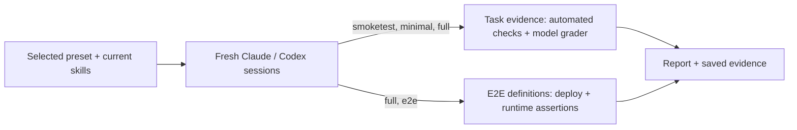

# Automation Pilot skill evaluations

**One entry point. Three levels of task coverage. A complete E2E workflow.**

[evals.sh](evals.sh) measures how well **Claude Code or Codex uses the current
Automation Pilot skills**. It runs predefined tasks in fresh agent workspaces,
captures the work, and checks whether requirements were met. Generated JSON is
validated for its contract and behavior; it is not scored by resemblance to a golden file.

[How the evals work](docs/HOW_IT_WORKS.md) · [Quick start](#quick-start) · [Presets](#choose-a-preset) · [Run commands](#run-a-preset) ·
[Models](#choose-agent-and-grader-models) · [Results](#read-the-results) ·
[Command reference](docs/commands.md) · [Current calibration](docs/CALIBRATION.md)

> [!IMPORTANT]
> **Full includes all 160 task evals plus agent-generated E2E.** Even the complete
> smoketest uses the real tenant for one engine case. For a first check with no
> tenant calls, use `check` or the four-case [local smoketest](#start-with-local-feedback).

## Quick start

You need **Go** and, for model runs, a logged-in **Claude Code or Codex CLI**.
The runner uses the CLI's existing authentication, provider and configured model.
There is no extra evaluator API key to configure.

From the repository root:

```sh
cd ~/Git/automation-pilot-agent-skills
export GOTOOLCHAIN="go$(cat cli/.go-version)"

# Validate the eval infrastructure and preview the smallest complete preset.
sh ci/evals/evals.sh check
sh ci/evals/evals.sh list --suite smoketest
```

These commands consume **no model tokens** and make **no tenant calls**.
The first Go invocation may download the toolchain or dependencies.

For real-engine and E2E checks, keep your existing destination configured through
**AUTOMATION_PILOT_HOSTNAME** and **AUTOMATION_PILOT_TOKEN**. The evaluator resolves
the tenant identity from that connection before model sessions. `--tenant` is an
optional identity assertion, never a destination override.

Native agent runs support macOS and Linux; use WSL on Windows. For stronger
filesystem isolation, see `--isolation bubblewrap` in the [command reference](docs/commands.md).
GitHub Actions runs offline validation only.

## Choose a preset

| Preset | When to run it | Coverage | Base model sessions¹ |
|---|---|---|---:|
| **`smoketest`** | First feedback after a skill edit | 12 tasks: one per skill | 12 agents + 11 graders |
| **`minimal`** | Broader checking before a complete campaign | The same 12 tasks plus 8 deeper cases | 20 agents + 19 graders |
| **`e2e`** | Check a complete automation across skills | Generate, deploy and test the full workflow | 1 larger agent session |
| **`full`** | Complete regression checking | All 160 tasks **and agent-generated E2E** | 160 agents + 137 graders + 1 E2E agent |

¹ Counts assume **one generation, no repairs**, before scripted follow-ups or
citation retries. E2E runtime assertions use deterministic grading. Smaller case
counts do not guarantee a particular token or dollar cost.

The task presets are nested. Their verification tiers are:

| Preset | Local | Simulated HTTPS API | Real Automation Pilot engine | Complete E2E |
|---|---:|---:|---:|---|
| smoketest | 4 | 7 | 1 | — |
| minimal | 11 | 7 | 2 | — |
| full | 80 | 56 | 24 | Included |

**Defaults:** one generation, no repair, one worker. Full and standalone E2E reject
`--case`, `--skill` and `--tier` filters so required coverage cannot be silently omitted.
Use smoketest/minimal for filtered checks; legacy bank-only selections are described
in the [command reference](docs/commands.md#run-models-budgets-filters-and-comparison).

## Run a preset

Each example below starts **one individual campaign**. Choose an agent and preset;
use a fresh run ID for each attempt. Timestamped IDs preserve earlier reports.
When delegating execution to an agent, approve model evals and calibration explicitly.

### Smoketest · 12 tasks

**Codex**

```sh
sh ci/evals/evals.sh run \
  --suite smoketest --agent codex \
  --run "smoketest-codex-$(date -u +%Y%m%dT%H%M%SZ)"
```

**Claude Code**

```sh
sh ci/evals/evals.sh run \
  --suite smoketest --agent claude --grader-model sonnet --grader-budget-usd 1 \
  --run "smoketest-claude-$(date -u +%Y%m%dT%H%M%SZ)"
```

### Minimal · 20 tasks

**Codex**

```sh
sh ci/evals/evals.sh run \
  --suite minimal --agent codex \
  --run "minimal-codex-$(date -u +%Y%m%dT%H%M%SZ)"
```

**Claude Code**

```sh
sh ci/evals/evals.sh run \
  --suite minimal --agent claude --grader-model sonnet --grader-budget-usd 1 \
  --run "minimal-claude-$(date -u +%Y%m%dT%H%M%SZ)"
```

### Full · 160 tasks + E2E

**Codex**

```sh
sh ci/evals/evals.sh run \
  --suite full --agent codex \
  --run "full-codex-$(date -u +%Y%m%dT%H%M%SZ)"
```

**Claude Code**

```sh
sh ci/evals/evals.sh run \
  --suite full --agent claude --grader codex --grader-budget-usd 1 \
  --run "full-claude-$(date -u +%Y%m%dT%H%M%SZ)"
```

### E2E · standalone workflow

Use either `--agent codex` or `--agent claude`:

```sh
sh ci/evals/evals.sh run \
  --suite e2e --agent codex \
  --run "e2e-codex-$(date -u +%Y%m%dT%H%M%SZ)"
```

To diagnose the harness or tenant using supplied reference definitions:

```sh
sh ci/evals/evals.sh run \
  --suite e2e --e2e-mode reference \
  --run "e2e-reference-$(date -u +%Y%m%dT%H%M%SZ)"
```

Reference mode needs **no Claude/Codex session**. It still deploys and executes tenant
resources, and its success establishes reference/service behavior rather than agent
authoring quality.

### Start with local feedback

This selects **four local tasks** and uses a cheaper Claude candidate:

```sh
sh ci/evals/evals.sh run \
  --suite smoketest --tier local --agent claude \
  --model haiku --grader-model sonnet \
  --run "local-smoketest-$(date -u +%Y%m%dT%H%M%SZ)"
```

It consumes model tokens but makes no real-tenant calls. Report it as a partial
smoketest, not a complete 12-case score.

## Choose agent and grader models

The **agent** solves the task. A separate **grader** assesses requirements that need
interpretation. Automated checks also inspect artifacts, tool actions and runtime
results. The grader cannot override a failed required automated check.

| Option | Controls | When omitted |
|---|---|---|
| `--agent claude` / `--agent codex` | Candidate CLI | Auto prefers installed Claude, then Codex |
| `--model MODEL` | Candidate model, including E2E generation | Candidate CLI's configured model |
| `--grader claude` / `--grader codex` | Grader CLI for independent tasks | Same CLI as the agent |
| `--grader-model MODEL` | Separate task-grading model | Grader CLI's configured model |
| `--effort` / `--grader-effort` | Reasoning effort for the corresponding CLI | Its configured effort |

A candidate model override does **not** implicitly set the grader model. Standalone
E2E uses runtime assertions; grader options apply to independent tasks only.

For example, use Codex to solve tasks and Claude Sonnet to grade them:

```sh
sh ci/evals/evals.sh run \
  --suite minimal --agent codex --grader claude \
  --model CODEX_MODEL_ID --effort low --grader-model sonnet \
  --run "minimal-mixed-$(date -u +%Y%m%dT%H%M%SZ)"
```

Replace CODEX_MODEL_ID with an ID supported by your provider. Claude aliases such as
`haiku`, `sonnet` and `opus` also depend on provider support. Pin candidate and grader
models for comparisons, and calibrate a changed grader before trusting its scores.

The [model cookbook](docs/models.md) contains copyable commands for both hosts,
configured defaults, all three task presets, candidate/grader pairings and mixed hosts.

## How verification works

Read the [concrete walkthrough](docs/HOW_IT_WORKS.md) for what gets generated,
what is asserted, what reaches the tenant, and where to inspect the evidence.



Independent tasks may ask for JSON, a plan, a review, discovery or an API operation.
**Local** checks inspect files and CLI validation. **Fixture** checks inspect actions
against a controlled HTTPS API with synthetic credentials. **Engine** checks execute
selected submissions in Automation Pilot. Reference answers help calibrate graders;
valid alternative implementations can satisfy the requirements.

E2E generation receives public contracts and scenario requirements, with reference
executor implementations withheld. The agent writes **19 definitions**: two catalogs,
five Inputs, ten commands and two MCP servers. The evaluator checks **29 core scenarios**,
MCP lifecycle, once-schedule delivery, feature groups and measurements. See
[E2E coverage](docs/E2E_COVERAGE.md) for the exact scope and remaining gaps.

The Go evaluator performs real-tenant operations; candidate sessions receive no real
tenant credentials through their environment. Native host configuration can influence
results and does not create an OS boundary around the hidden evaluation bank.

## Control cost and runtime

| Option | Default | Meaning |
|---|---:|---|
| `--runs` | 1 | Independent generations; each full generation includes E2E |
| `--repair` | 0 | Set to 1 for a separately scored repair |
| `--parallel` | 1 | Task workers; E2E remains sequential |
| `--budget-usd` | 0 | Overall reservation limit; 0 disables the campaign cap |
| `--case-budget-usd` | 1 | Per-task candidate reservation |
| `--grader-budget-usd` | 0.25 | Per-task semantic-grader reservation |
| `--e2e-budget-usd` | 5 | Per-E2E candidate/repair reservation |
| `--e2e-timeout` | 45m | E2E generation and acceptance deadline |

E2E can take tens of minutes. Its once-schedule check alone waits up to nine minutes.
A budget stop leaves required work as UNRUN and makes the campaign incomplete.

Claude reports USD cost and supports its session budget option. Codex does not report
USD: reservations and usage counters are **not enforceable provider billing caps**.
Reported zero cost may mean pricing is unavailable. Reference E2E has no model-session
reservation. Repairs preserve first-attempt failures and are recorded separately.

## Read the results

Results live under **`ci/evals/runs/RUN_ID/`**, ignored by Git. Substitute your printed
run ID for RUN_ID below. Paths passed to the launcher resolve from `ci/evals/`.

```sh
# Display saved results.
sh ci/evals/evals.sh report --run runs/RUN_ID
```

```sh
# Export Markdown; the output file must be fresh.
sh ci/evals/evals.sh report --run runs/RUN_ID \
  --out runs/RUN_ID/summary.md
```

```sh
# Compare compatible campaigns.
sh ci/evals/evals.sh report --run runs/NEW_RUN_ID \
  --compare runs/BASELINE_RUN_ID/report.json
```

Reporting consumes no model tokens and makes no tenant calls. Comparisons require
compatible models, CLI configuration, selection, grading protocol and E2E requirements.

| Verdict | Meaning |
|---|---|
| **PASS** | Required verification completed successfully |
| **FAIL** | Captured work violated a requirement |
| **EVALUATOR_ERROR** | A host, grader, reporting or cleanup operation failed |
| **UNVERIFIED** | Required runtime verification was blocked or incomplete |
| **UNRUN** | Excluded or never started; inspect the recorded reason |

`report.json` separates **`results`** for task scores and **`e2e`** for workflow scores.
It records checks, evidence paths, model/configuration details, latency, usage and
available cost data. Repairs have separate results. E2E assertions do not inflate
independent task pass rates.

The run command succeeds only when all selected first attempts and required workflow
checks pass. An incomplete report does not establish an overall skill-quality score.

> [!NOTE]
> Current calibration passes all 414 challenges with Codex, and the smoketest/minimal
> selections with Sonnet. Sonnet is not qualified for full. Calibration validates
> graders and reference expectations; independent case review and a fresh full
> candidate campaign remain pending. See [current calibration](docs/CALIBRATION.md).

## Cleanup and recovery

The runner attempts automatic cleanup of recorded engine and E2E resources. Cleanup
has its own time bound: three minutes for engine probes, five for E2E. Interruptions
or failed mutations can leave resources; retain the journals until absence is verified.

```sh
sh ci/evals/evals.sh cleanup --run runs/RUN_ID
```

Use the same AUTOMATION_PILOT_HOSTNAME/AUTOMATION_PILOT_TOKEN destination. Cleanup
verifies tenant identity and targets recorded IDs. An ambiguous submission requires
reconciliation; cleanup does not guess or blindly replay the mutation.

## Files and further reading

```text
ci/evals/
├── evals.sh           # Single user entry point
├── readme.md          # This run guide
├── cases/            # 160-case bank, schema and source inventory
├── runner/           # Agent adapters, orchestration, grading and reporting
├── e2e/              # Acceptance library and supplied reference definitions
├── docs/             # Command/model reference, coverage and status
└── runs/             # Local reports, definitions, evidence and journals (ignored)
```

| Guide | Use it for |
|---|---|
| [How the evals work](docs/HOW_IT_WORKS.md) | Concrete generation, assertion and deployment walkthroughs |
| [Command reference](docs/commands.md) | Every subcommand, flag and example |
| [Model cookbook](docs/models.md) | Claude/Codex and candidate/grader combinations |
| [Case format](docs/CASE_FORMAT.md) | Creating and maintaining evals |
| [Task coverage](docs/COVERAGE.md) | Independent task-bank coverage |
| [E2E coverage](docs/E2E_COVERAGE.md) | Runtime scenarios, feature groups and limits |
| [Current calibration](docs/CALIBRATION.md) | Qualified grader profiles and reference/runtime checks |
| [Validation status](docs/STATUS.md) | Current limitations and historical candidate campaigns |
| [Historical design](docs/history/README.md) | Original research and rollout notes |

The older four-case harness is retired; its behavioral requirements remain in the
current bank. Historical task reports are preserved in `runs/`, and older live
acceptance journals in `runs/legacy-e2e/`. Another checkout will not contain these
Git-ignored local reports.
